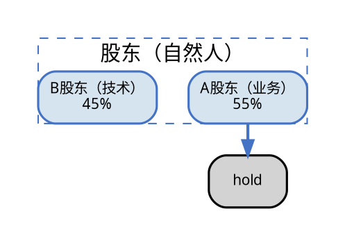
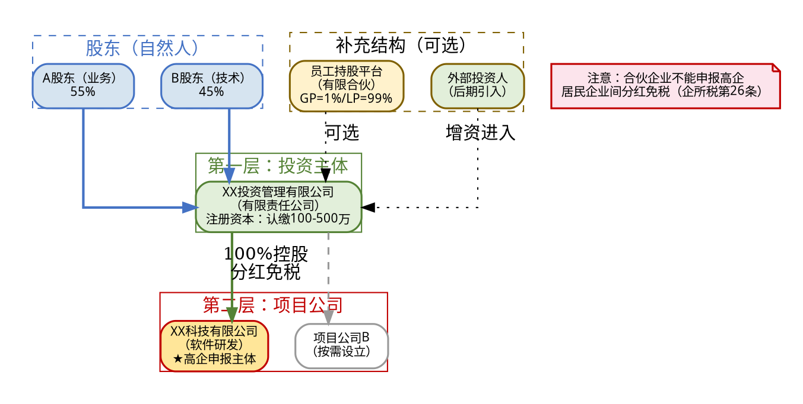

# Graphviz 架构图嵌入 Word 文档指南

在财税咨询方案中，经常需要生成股权架构图、公司层级结构图、重组方案示意图等。本指南提供从 Graphviz DOT 画图到嵌入 python-docx 的完整流程。

## 适用场景

- 股权架构方案图（自然人股东 → 投资公司 → 项目公司）
- 企业重组路径图（旧实体注销 → 新实体设立 → 业务平移）
- 税务筹划逻辑图（实体层级 + 税务处理标注）
- 多层级控股关系图（GP/LP 结构、员工持股平台）

## 技术栈

- **画图：** Graphviz (`dot` 命令行工具)
- **后处理：** Pillow（检查图片尺寸）
- **文档嵌入：** python-docx `doc.add_picture()`

## 核心流程

### 1. 编写 DOT 源码

DOT 是 Graphviz 的图描述语言。关键要点：



### 2. 中文字体问题（关键！）

Graphviz 默认字体不含中文，必须手动指定中文字体。

**方案A：系统已安装中文字体**
- Ubuntu: `apt install fonts-wqy-microhei`
- 在 DOT 源码中设 `fontname="SimHei"` 或 `fontname="WenQuanYi Micro Hei"`

**方案B：失败回退**
- 替换 DOT 源码中所有 `SimHei` 为 `Arial`
- 中文将显示为方块，但图结构完整可用
- 或者用 Pillow 手工画替代图（见下文故障处理）

### 3. 生成 PNG 图片

```python
import subprocess, os

out_dir = '/tmp/arch_diagram'
os.makedirs(out_dir, exist_ok=True)

dot_path = os.path.join(out_dir, 'arch.dot')
png_path = os.path.join(out_dir, 'arch.png')

# 写入 DOT
with open(dot_path, 'w', encoding='utf-8') as f:
    f.write(dot_code)   # 你的 DOT 源码字符串

# 生成 PNG（200dpi 保证清晰度）
result = subprocess.run(
    ['dot', '-Tpng', '-Gdpi=200', dot_path, '-o', png_path],
    capture_output=True, text=True
)

if result.returncode != 0:
    print(f"Graphviz 失败: {result.stderr}")
    # 尝试英文字体回退
    dot_code_en = dot_code.replace('SimHei', 'Arial')
    ...
```

### 4. 嵌入 Word 文档

```python
from docx.shared import Inches

# 插入图片（宽度控制）
doc.add_picture(png_path, width=Inches(6.2))

# 居中
last_paragraph = doc.paragraphs[-1]
last_paragraph.alignment = WD_ALIGN_PARAGRAPH.CENTER

# 图注
p = doc.add_paragraph()
p.alignment = WD_ALIGN_PARAGRAPH.CENTER
run = p.add_run('图1：推荐股权架构示意图')
run.font.bold = True
run.font.size = Pt(9)
```

## 实战案例：股权架构图模板

见下方代码模板，是一个包含三层结构的股权架构图 DOT 源码框架：

```
第一层：自然人股东（A/B 的持股比例）
    ↓
第二层：投资管理有限公司（有限责任公司，100-500万注册资本）
    ↓
第三层：项目公司（高企申报主体）+ 其他项目公司

补充结构（虚线表示可选）：
    员工持股平台（有限合伙 GP/LP）
    外部投资人（增资进入）
    注意框（法律/税务提醒）
```

### 完整结构模板



## 颜色方案（财税咨询风格）

| 层级 | 颜色 | 色值 | 填充 |
|------|------|------|------|
| 自然人股东 | 蓝色 | #4472C4 | #D6E4F0 |
| 投资公司 | 绿色 | #548235 | #E2EFDA |
| 高企主体 | 红色 | #C00000 | #FFE699 |
| 其他项目 | 灰色 | #999999 | #FFFFFF |
| 补充结构 | 棕色 | #7F6000 | #FFF2CC |
| 注意框 | 红色 | #C00000 | #FCE4EC |

## 常见问题处理

### 1. Graphviz 未安装
```bash
sudo apt-get install -y graphviz
```

### 2. 中文显示为方块
- 安装中文字体：`sudo apt-get install -y fonts-wqy-microhei`
- DOT 源码中设 `fontname="WenQuanYi Micro Hei"`
- 如果仍有问题，用 `fontname="Arial"` 回退（中文变方块但图可看）

### 3. DOT 源码中的中文转义
在 Python 字符串中嵌入 DOT 代码时，中文可以直接写在字符串里（UTF-8 字符串），不需要 Unicode 转义。但要注意 Python 字符串定界符的选择——如果中文含双引号，用三重引号包裹。

### 4. Graphviz 出图失败后的备用方案
用 Pillow 画一张简化示意图（矩形+箭头）：

```python
from PIL import Image, ImageDraw, ImageFont

img = Image.new('RGB', (900, 700), 'white')
draw = ImageDraw.Draw(img)
font = ImageFont.truetype('/usr/share/fonts/truetype/wqy/wqy-microhei.ttc', 16)

def draw_box(d, x, y, w, h, lines, fill, border):
    d.rounded_rectangle([x, y, x+w, y+h], radius=8,
                        fill=fill, outline=border, width=2)
    for i, line in enumerate(lines):
        bbox = d.textbbox((0, 0), line, font=font)
        tw = bbox[2] - bbox[0]
        d.text((x + w/2 - tw/2, y + 20 + i*24), line,
               fill='black', font=font)

draw_box(draw, 80, 30, 200, 60, ["A股东（业务）55%"], "#D6E4F0", "#4472C4")
draw_box(draw, 620, 30, 200, 60, ["B股东（技术）45%"], "#D6E4F0", "#4472C4")
draw_box(draw, 300, 150, 300, 80, ["XX投资管理有限公司", "（有限责任公司）"], "#E2EFDA", "#548235")
draw_box(draw, 300, 300, 300, 80, ["XX科技有限公司", "（软件研发·高企申报主体）"], "#FFE699", "#C00000")
```

### 5. Word 图片插入后过大或过小
`doc.add_picture(png_path, width=Inches(6.2))` — 宽度 6.2 英寸适合 A4 页面的单栏布局。如果想更小，设为 `Inches(5.0)` 或 `Inches(4.5)`。

## 生成脚本验证标准

交付前检查：
1. PNG 图片存在且 > 10KB
2. Word 文件存在且 > 20KB
3. 用 `python3 -c "from PIL import Image; Image.open('arch.png')"` 确认图片无损坏
4. 图片尺寸合理（建议宽度 3000-5000px @200dpi）
